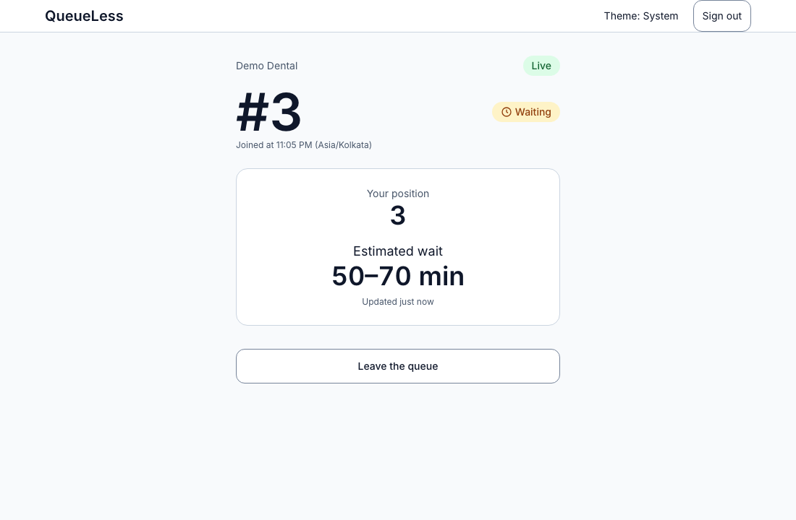
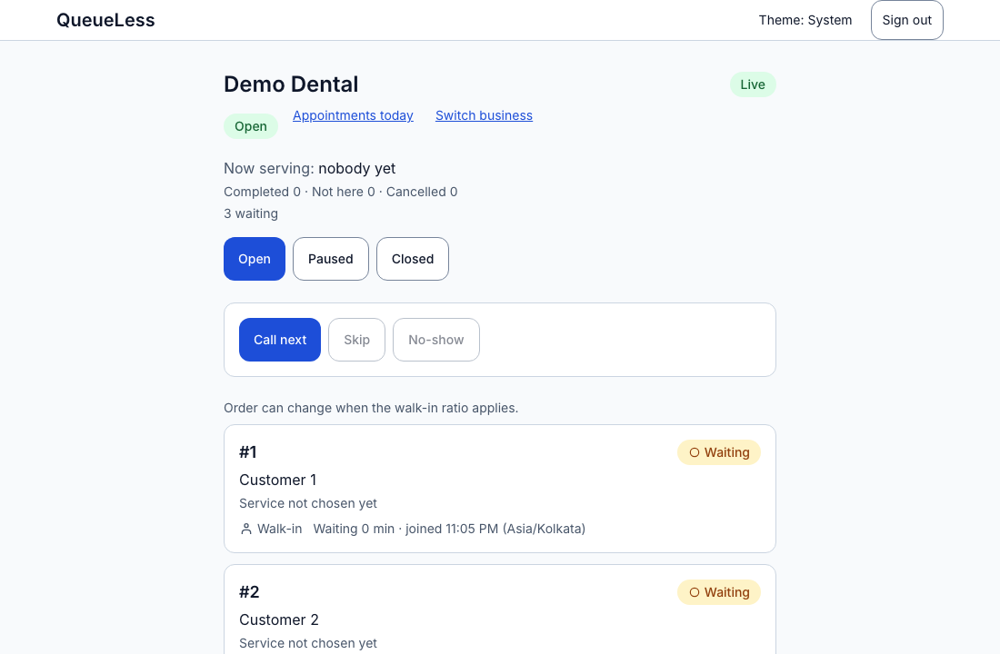
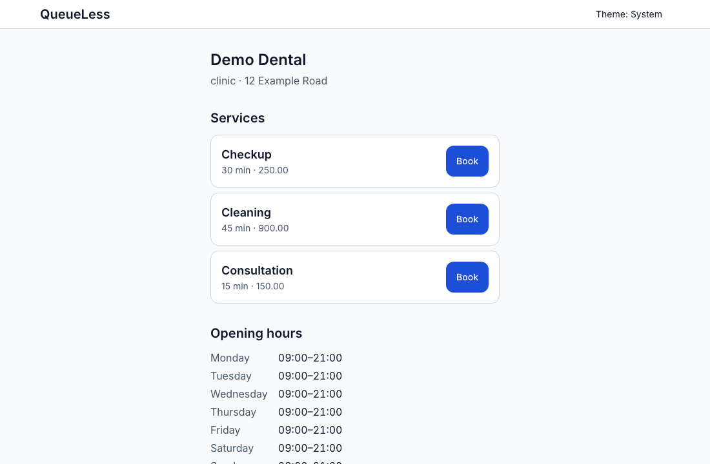

# QueueLess

Multi-tenant live queue for service businesses: appointments and walk-in tokens in one queue, with real-time position and ETA.

A customer books a slot or joins today's queue and watches their position and estimated wait update live. Staff run the queue from one console. Owners set up the business, services, staff and opening hours, and read simple reports.

> Portfolio project. There is no hosted demo yet, and sign-in codes are not sent by SMS (see [Signing in](#signing-in)). Do not enter real personal data.

## Screenshots

Taken from a local run with made-up data (a demo clinic and placeholder customers).

| Customer: live ticket | Staff: queue console | Public business page |
| --- | --- | --- |
|  |  |  |

## What is in it

- **One queue** for appointments and walk-in tokens, with deterministic ordering and a configurable walk-in ratio.
- **Live updates** over Server-Sent Events: position and an ETA range, with `Last-Event-ID` resume, a fresh short-lived stream token per connection, and polling as a fallback.
- **Staff console:** open, pause or close the queue; call next, skip, mark no-show; appointments for today with check-in.
- **Owner area:** create a business, services, staff and opening hours, plus a dashboard (peak hours, wait times, no-shows).
- **Safe writes:** `Idempotency-Key` on mutating requests, optimistic locking with a `version` on tokens, database constraints against double booking, per-IP and per-user rate limits.

## Architecture

```text
Browser ── Next.js 16 web (:3000) ──► FastAPI API (:8000) ──► PostgreSQL 16   source of truth
   ▲                                      │      ▲              (appointments, tokens, outbox)
   │  Server-Sent Events                  ▼      │
   └──────────────────────────────────  Redis 7  ◄── arq worker (cron jobs + outbox relay)
                                       rate limits, OTP codes, pub/sub, job queue
```

- State changes write an outbox row in the same database transaction. The worker relays it to Redis, and the API fans it out to open streams. Redis can be lost without losing durable state.
- The backend is FastAPI with async SQLAlchemy, Alembic migrations and Pydantic. The web app is Next.js (App Router) with TypeScript and TanStack Query. Types for the API come from its OpenAPI schema (`npm run api:types`).
- Tests: backend `pytest` against real Postgres and Redis through testcontainers; web unit tests with Vitest; end-to-end tests with Playwright on Chromium, Firefox and WebKit.

## Local setup

Requires Docker. Optional for running checks outside Docker: Python 3.12 with [uv](https://docs.astral.sh/uv/), Node 24 with npm.

```text
cp .env.example .env
```

Open `.env` and fill the three blank `POSTGRES_USER`, `POSTGRES_PASSWORD` and `POSTGRES_DB` values with any values you like. They only protect a database that listens on `127.0.0.1`. Set `POSTGRES_HOST_PORT` too if port 5432 is taken. Leave the other blank values alone: Compose supplies local-only placeholders for the signing secrets, and the API rejects them unless `APP_ENV=local`.

```text
docker compose up -d postgres redis
docker compose run --rm api alembic upgrade head
docker compose up api worker web      # add -d to run in the background
# API: http://localhost:8000 (OpenAPI at /docs)   Web: http://localhost:3000
```

The first start builds the images, which takes a few minutes. Compose binds to localhost only because the placeholder secrets are public; never expose these ports on a shared network.

### First run: create some data

A fresh database is empty and there is no seed script yet, so create a small business through the web app:

1. Open <http://localhost:3000/register> and create an owner account (name, email, password). Registering signs you in and takes you to the owner area; later you sign in at <http://localhost:3000/signin>.
2. Choose **Create a business**: a name, a category (required), a time zone, and opening hours (there are defaults). The owner area then lists the business with links to its queue console, services, staff, settings and dashboard. Open **Services**, choose **Add a service**, fill it in and **Save**.
3. Optional: under **Staff** choose **Add a staff member** (name, email, first password). That person signs in at `/signin` and lands in the queue console.
4. As a customer, open <http://localhost:3000/login>, enter a phone number, and take the code from the API log (below). Then find the business in the search at <http://localhost:3000/b>, open it, and join the queue or book a slot.

### Signing in

Owners and staff sign in with email and password. Customers sign in with a phone number and a one-time code. Only a mock SMS provider exists, so no message is sent: the code is written to the API log, and only when `APP_ENV` is `local` or `test`:

```text
docker compose logs api | grep "MOCK SMS"     # MOCK SMS to ***3210: OTP code 123456
```

## Checks

```text
cd backend && uv sync && uv run ruff check . && uv run ruff format --check . && uv run mypy && uv run pytest   # pytest needs Docker
cd web && npm ci && npm run lint && npm run typecheck && npm run build
cd web && npm test                                                                                           # unit tests
```

The end-to-end suite runs the same stack as CI: `web/scripts/e2e-stack.sh --fresh` (Docker needed; `E2E_BROWSERS="chromium"` limits the browsers).

## License

[MIT](LICENSE)
